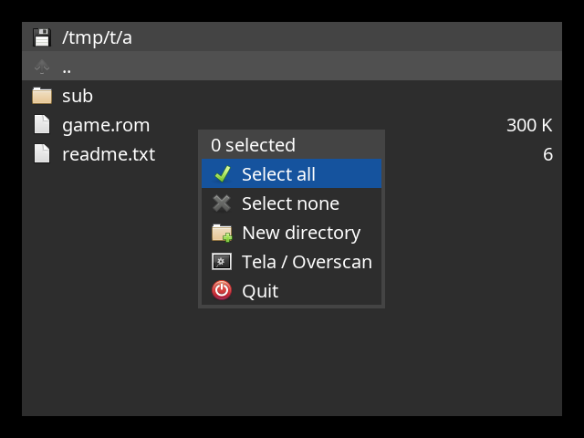
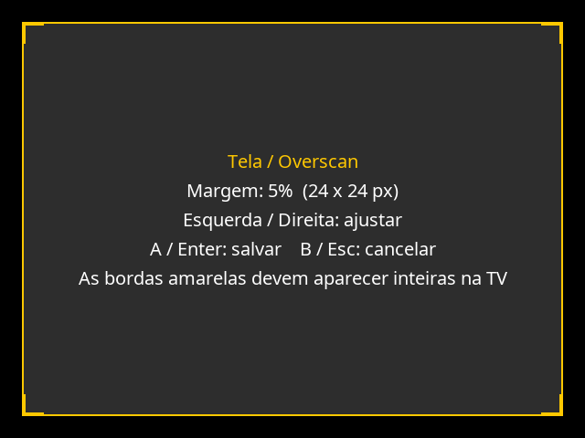
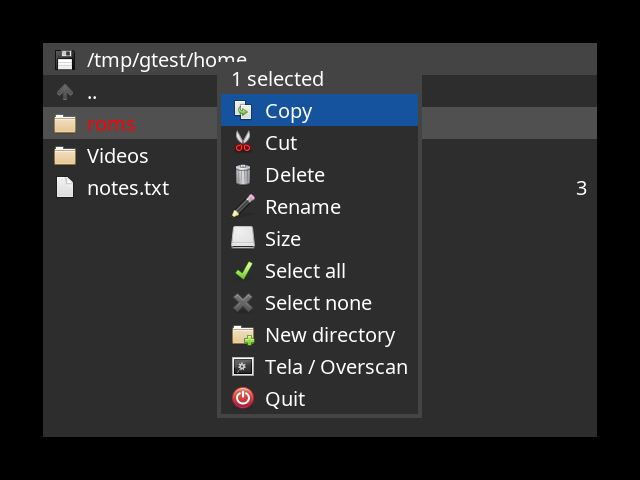

# MiSTerFiles

A single-panel file manager that runs **on the MiSTer FPGA itself** (from the Scripts menu, with a gamepad or keyboard) and on **x86_64 Linux arcade cabinets** running GroovyArcade. Copy, cut, paste, delete, rename, create folders, view images and text, and edit text — without needing a PC.

This is a fork of [351Files](https://github.com/Tardigrade-nx/351Files) by Tardigrade-nx (itself based on DinguxCommander), extended with a framebuffer / SDL video layer, arcade-friendly controls, and a **Tela / Overscan** setting for CRT TVs that crop the edges of the picture.

Pre-built packages are in [Releases](https://github.com/SuperRPG/MiSTerFiles/releases). Longer guides in Portuguese: [README-pt-BR.md](README-pt-BR.md) (MiSTer) and [README-GroovyArcade-pt-BR.md](README-GroovyArcade-pt-BR.md) (GroovyArcade).

<p align="center">
  <br>
  <em>MiSTer — context menu (640×480, overscan on)</em><br><br>
  <br>
  <em>Tela / Overscan — yellow frame marks the safe area</em><br><br>
  <br>
  <em>GroovyArcade — same interface and overscan control (640×480)</em>
</p>

## Install on MiSTer

Download **`MiSTerFiles.zip`** from the [latest release](https://github.com/SuperRPG/MiSTerFiles/releases/latest). Copy the contents of the `Scripts` folder onto the MiSTer at `/media/fat/Scripts` (FTP, SMB, or directly on the SD card). You should end up with:

```
/media/fat/Scripts/MiSTerFiles.sh
/media/fat/Scripts/.MiSTerFiles/MiSTerFiles
/media/fat/Scripts/.MiSTerFiles/res/...
```

The `.MiSTerFiles` folder starts with a dot on purpose, so it does not show up in the Scripts menu.

On the MiSTer: **F12 → Scripts → MiSTerFiles**. To quit: **Y** (or **Tab**) → **Quit**. The MiSTer then shows “Press any key to continue”; press any key or button to return to the menu.

The binary is fully static (SDL2, SDL2_image, SDL2_ttf and FreeType are linked in). Each run writes a log to `/tmp/MiSTerFiles.log` (the previous one is kept as `/tmp/MiSTerFiles.log.old`).

### `fb_terminal` and opening the script twice

The app draws on the Linux framebuffer. The MiSTer menu only enables that framebuffer for scripts when `fb_terminal` is **not** `0` in `MiSTer.ini`.

- If your `MiSTer.ini` has **`fb_terminal=0`** (common on a CRT over component / VGA with `vga_scaler=0`), you do **not** need to edit the file. The first time you start MiSTerFiles, the script explains this in the OSD, turns `fb_terminal` on **temporarily** (it bind-mounts a copy of the ini from `/tmp`; the file on the SD card is not changed) and reloads the menu. Open **Scripts → MiSTerFiles** a second time and the app starts. On exit, the mount is removed and the menu reloads with your original ini.
- Leaving `fb_terminal=2` permanently can hide the MiSTer menu picture on some CRT setups, so the default of `0` plus “open twice” is the safe option.
- To skip the extra open, you can set in the `[MiSTer]` section:
  - Analog CRT 15 kHz (`vga_scaler=0`, `direct_video=0`): `fb_terminal=2` (640×240 framebuffer on the TV)
  - HDMI: `fb_terminal=1`
- With `fb_terminal=1` and `vga_scaler=0`, the framebuffer is **not** sent to the analog output (HDMI only). Use `2` on a CRT.
- On a 15 kHz CRT the app automatically uses the compact 240-line layout. You can force `LAYOUT=small` or `LAYOUT=large` in `MiSTerFiles.ini`.

### Optional settings (MiSTer)

Copy `.MiSTerFiles/MiSTerFiles.ini.example` to `.MiSTerFiles/MiSTerFiles.ini` if you want to edit by hand. The overscan screen writes `OVERSCAN=` into that file for you.

- `OVERSCAN` — safe-area margin as a percent (see below)
- `FB_WIDTH` / `FB_HEIGHT` — empty = automatic (CRT: 640×240; HDMI: 640×480)
- `LAYOUT` — `auto`, `small`, or `large`
- `AUTO_FB=0` — do not enable the framebuffer temporarily; only show what to change in the ini
- `START_DIR` — start folder (default `/media/fat`)
- `MF_JOYSTICK=1` — also read the pad through SDL (only if the MiSTer mapping does not work; can cause double movement)
- `MF_SWAP_RB=1` — swap red/blue if colors look wrong

**Be careful:** the app can modify any file on the MiSTer, including `/media/fat/linux` and `MiSTer.ini`. Deletes are permanent.

## Install on GroovyArcade

The cabinet does not need internet or `pacman`. Download **`MiSTerFiles-groovyarcade.tar.gz`** from the [latest release](https://github.com/SuperRPG/MiSTerFiles/releases/latest) and take it over on a USB stick. Prefer the `.tar.gz` over a loose folder: it keeps the executable bits that FAT32/exFAT drop.

On a PC, copy `MiSTerFiles-groovyarcade.tar.gz` to the root of the stick and eject it safely.

On the cabinet, open a text terminal (GroovyArcade / gasetup shell, or `Ctrl+Alt+F2`; return to the frontend with `Ctrl+Alt+F7` or F1). Then, replacing `sdb1` with the device `lsblk -f` shows:

```bash
sudo mkdir -p /mnt/usb && sudo mount /dev/sdb1 /mnt/usb
tar -xzf /mnt/usb/MiSTerFiles-groovyarcade.tar.gz -C /home/arcade/
sudo chown -R arcade: /home/arcade/MiSTerFiles
chmod +x /home/arcade/MiSTerFiles/MiSTerFiles /home/arcade/MiSTerFiles/*.sh
cd /; sync; sudo umount /mnt/usb
```

To run it (as user `arcade`):

```bash
# Frontend still running under X; command typed on another tty (Ctrl+Alt+F2):
DISPLAY=:0 /home/arcade/MiSTerFiles/MiSTerFiles.sh
# Then switch back to the frontend screen (Ctrl+Alt+F7) to see the app.

# No X (frontend closed, GroovyArcade on KMS):
/home/arcade/MiSTerFiles/MiSTerFiles.sh
```

To add it to Attract-Mode / Attract-Mode Plus, run `/home/arcade/MiSTerFiles/instalar-attract.sh` as `arcade`, then in Attract-Mode add a display that uses the `MiSTerFiles` romlist.

Settings are stored in `MiSTerFiles.ini` next to the binary if that folder is writable, otherwise in `~/.config/MiSTerFiles/`. The log is `/tmp/MiSTerFiles.log`. Full USB, video, and troubleshooting notes are in [README-GroovyArcade-pt-BR.md](README-GroovyArcade-pt-BR.md).

The GroovyArcade build has been tested on a regular Linux PC (including 640×480, 640×240 and 320×240). Joystick / arcade-encoder buttons, launching from Attract-Mode, and a real 15 kHz CRT still need a test on the cabinet itself.

## Controls

On **MiSTer**, Main already turns the mapped gamepad into keys when a script runs on screen, so buttons follow the mapping you set in the MiSTer menu:

| Action | Gamepad | Keyboard |
|---|---|---|
| Move | D-pad | Arrow keys |
| Open / confirm | A | Enter |
| Back / parent folder | B | Esc or Backspace |
| Mark file | X | Space or Insert |
| Context menu (copy, paste, delete, rename, Tela / Overscan, Quit…) | Y | Tab, X, or F1 |
| Page up / down | L / R | PgUp / PgDn (Home / End) |

On **GroovyArcade**, keyboard / I-PAC-style encoders and SDL gamepads are both supported. Defaults match common MAME player-1 bindings (Left Ctrl = A, Left Alt = B, Left Shift = menu). Bindings are configurable in `MiSTerFiles.ini` (`KEY_*`, `JOY_*`). See the GroovyArcade README for the full table.

## Tela / Overscan

CRT TVs often crop the edges of the picture. The same control works on both targets:

1. Press **Y** (or **Tab**) and choose **Tela / Overscan** (just above *Quit*).
2. A yellow frame marks the safe area. Use Left/Right (or Up/Down) until the whole frame is visible on the TV.
3. **A / Enter** saves, **B / Esc** cancels.

The whole UI (list, menus, dialogs, on-screen keyboard) is then drawn inside that area; outside it stays black. The value is stored as `OVERSCAN=<n>` in `MiSTerFiles.ini`.

`OVERSCAN` is a percentage of the **screen height** (0–15), applied on all four sides. Side margins are scaled for the TV aspect (`ASPECT=4:3` by default, or `16:9`) so they have the same visual size as the top/bottom margins — for example at 640×240, 10% is 24 lines top/bottom and 48 pixels left/right. Because it is a percentage, the same number works at 640×240, 640×480, and 320×240. Default: 0.

## Building from source

The source lives at the repository root (this is a git fork of 351Files, with the original history kept under the `upstream` remote). Build scripts, CMake toolchains, and launchers are also at the root. Dependencies are downloaded into `deps/` (gitignored) and are not required on the target machine.

**MiSTer** (static ARMv7 hard-float), on Debian/Ubuntu x86_64:

```bash
sudo apt install g++-arm-linux-gnueabihf cmake make wget zip
./build_MiSTer.sh
```

Produces `dist/` and `MiSTerFiles.zip`.

**GroovyArcade** (x86_64, linked against a glibc 2.28 sysroot so it runs on distros since ~2018):

```bash
sudo apt install g++ cmake make curl wget zip dpkg dpkg-deb \
  libx11-dev libxext-dev libxrandr-dev libxcursor-dev libxi-dev libxfixes-dev \
  libxss-dev libxinerama-dev libdrm-dev libgbm-dev libegl-dev libgles-dev libgl-dev libudev-dev
./build_GroovyArcade.sh
```

Produces `dist-groovy/` and `MiSTerFiles-groovyarcade.tar.gz`. SDL is built with X11 and KMSDRM and `dlopen()`s the system libraries at runtime.

Platform-specific code is in `src/mister.cpp`, `src/mister.h`, `src/overscan.cpp`, and the `DEVICE_MISTER` / `DEVICE_GROOVY` / `MF_PLATFORM` blocks. `MiSTerFiles.patch` is a combined diff against upstream 351Files.

## Credits and license

MiSTerFiles is a fork of **[351Files](https://github.com/Tardigrade-nx/351Files)** by Tardigrade-nx, which is based on [DinguxCommander](https://tardigrade-nx.github.io/2011/dinguxcommander). It is released under the same license as the upstream project, the [GNU General Public License v3.0](LICENSE). The original 351Files README is kept in [README-upstream.md](README-upstream.md).

Other bundled components: SDL2 / SDL2_image / SDL2_ttf (zlib), FreeType (FTL), Noto fonts (OFL). Copies are in `launcher/licenses/`.

---

# Português (Brasil)

Gerenciador de arquivos de um painel só, que roda **no próprio MiSTer** (menu Scripts, com controle ou teclado) e no **fliperama com GroovyArcade** (Linux x86_64). Copiar, recortar, colar, apagar, renomear, criar pasta, ver imagens e textos, editar texto — sem precisar do PC.

É um fork do [351Files](https://github.com/Tardigrade-nx/351Files) de Tardigrade-nx (baseado no DinguxCommander), com saída de vídeo para o framebuffer / SDL, controles de arcade e o ajuste **Tela / Overscan** para TV de tubo que corta as bordas.

Os pacotes prontos estão em [Releases](https://github.com/SuperRPG/MiSTerFiles/releases). Guias mais detalhados: [README-pt-BR.md](README-pt-BR.md) (MiSTer) e [README-GroovyArcade-pt-BR.md](README-GroovyArcade-pt-BR.md) (GroovyArcade).

## Instalação no MiSTer

Baixe o **`MiSTerFiles.zip`** da [versão mais recente](https://github.com/SuperRPG/MiSTerFiles/releases/latest). Copie o conteúdo da pasta `Scripts` para `/media/fat/Scripts` do MiSTer (FTP, SMB ou no cartão SD):

```
/media/fat/Scripts/MiSTerFiles.sh
/media/fat/Scripts/.MiSTerFiles/MiSTerFiles
/media/fat/Scripts/.MiSTerFiles/res/...
```

A pasta `.MiSTerFiles` começa com ponto de propósito, para não aparecer no menu Scripts.

No MiSTer: **F12 → Scripts → MiSTerFiles**. Para sair: **Y** (ou **Tab**) → **Quit**. O MiSTer mostra “Press any key to continue”; aperte qualquer tecla ou botão para voltar ao menu.

O binário é estático (SDL2, SDL2_image, SDL2_ttf e FreeType já vão dentro). O log de cada execução fica em `/tmp/MiSTerFiles.log` (o anterior em `/tmp/MiSTerFiles.log.old`).

### `fb_terminal` e abrir o script duas vezes

O app desenha no framebuffer do Linux, e o menu do MiSTer só liga esse framebuffer para scripts quando `fb_terminal` é **diferente de 0** no `MiSTer.ini`.

- Se o seu `MiSTer.ini` tem **`fb_terminal=0`** (comum em CRT por componente / VGA com `vga_scaler=0`), **não precisa editar o arquivo**. Na primeira vez o script avisa na janela do OSD, ativa o `fb_terminal` *temporariamente* (monta uma cópia do ini em `/tmp`; o arquivo no cartão não é alterado) e recarrega o menu. Abra **Scripts → MiSTerFiles** de novo e o app abre. Ao sair, o mount é desfeito e o menu volta com o seu ini original.
- Deixar `fb_terminal=2` o tempo todo pode esconder a imagem do menu do MiSTer em alguns CRTs, então o padrão `0` e “abrir duas vezes” é o caminho mais seguro.
- Para não passar por esse recarregamento, na seção `[MiSTer]`:
  - TV/CRT pela saída analógica sem scaler (`vga_scaler=0`, `direct_video=0`): `fb_terminal=2` (framebuffer 640×240 a 15 kHz, aparece na TV)
  - HDMI: `fb_terminal=1`
- Com `fb_terminal=1` e `vga_scaler=0`, a imagem do framebuffer **não** sai na saída analógica (só no HDMI) — em CRT, use `2`.
- Em CRT 15 kHz o app usa automaticamente o layout compacto (240 linhas). Dá para forçar com `LAYOUT=small` ou `LAYOUT=large` no `MiSTerFiles.ini`.

### Ajustes opcionais (MiSTer)

Copie `.MiSTerFiles/MiSTerFiles.ini.example` para `.MiSTerFiles/MiSTerFiles.ini` se quiser editar na mão. A tela de overscan grava o `OVERSCAN=` sozinha.

Ele mexe em qualquer arquivo do MiSTer (inclusive `/media/fat/linux` e o `MiSTer.ini`). Apagar é definitivo.

## Instalação no GroovyArcade

O gabinete não precisa de internet nem de `pacman`. Baixe o **`MiSTerFiles-groovyarcade.tar.gz`** da [versão mais recente](https://github.com/SuperRPG/MiSTerFiles/releases/latest) e leve num pendrive. Use o `.tar.gz`: ele guarda a permissão de execução que FAT32/exFAT perdem.

No PC, copie o arquivo para a raiz do pendrive e ejete com segurança.

No gabinete, abra um terminal de texto (menu do GroovyArcade / gasetup, ou `Ctrl+Alt+F2`; para voltar ao frontend, `Ctrl+Alt+F7` ou F1). Troque `sdb1` pelo dispositivo que o `lsblk -f` mostrar:

```bash
sudo mkdir -p /mnt/usb && sudo mount /dev/sdb1 /mnt/usb
tar -xzf /mnt/usb/MiSTerFiles-groovyarcade.tar.gz -C /home/arcade/
sudo chown -R arcade: /home/arcade/MiSTerFiles
chmod +x /home/arcade/MiSTerFiles/MiSTerFiles /home/arcade/MiSTerFiles/*.sh
cd /; sync; sudo umount /mnt/usb
```

Para abrir (usuário `arcade`):

```bash
# Frontend rodando no X; comando dado em outro terminal (Ctrl+Alt+F2):
DISPLAY=:0 /home/arcade/MiSTerFiles/MiSTerFiles.sh
# Volte para a tela do frontend (Ctrl+Alt+F7) para ver o app.

# Sem X (frontend fechado, GroovyArcade em modo KMS):
/home/arcade/MiSTerFiles/MiSTerFiles.sh
```

Para colocar no Attract-Mode / Attract-Mode Plus, rode `/home/arcade/MiSTerFiles/instalar-attract.sh` como `arcade` e, no Attract-Mode, adicione um display com a romlist `MiSTerFiles`.

A configuração fica no `MiSTerFiles.ini` ao lado do binário (se a pasta puder ser gravada) ou em `~/.config/MiSTerFiles/`. O log fica em `/tmp/MiSTerFiles.log`. O passo a passo completo, vídeo e problemas comuns estão em [README-GroovyArcade-pt-BR.md](README-GroovyArcade-pt-BR.md).

A versão GroovyArcade foi testada em um Linux de PC (incluindo 640×480, 640×240 e 320×240). O controle e os botões do encoder, a abertura pelo Attract-Mode e a imagem em 15 kHz ainda precisam de teste no gabinete.

## Controles

No **MiSTer**, o menu já converte o controle mapeado em teclas quando um script roda na tela, então os botões seguem o mapeamento que você fez no menu do MiSTer:

| Ação | Controle | Teclado |
|---|---|---|
| Mover | D-pad | Setas |
| Abrir / confirmar | A | Enter |
| Voltar / pasta acima | B | Esc ou Backspace |
| Marcar arquivo | X | Espaço ou Insert |
| Menu (copiar, colar, apagar, renomear, Tela / Overscan, sair…) | Y | Tab, X ou F1 |
| Página acima / abaixo | L / R | PgUp / PgDn (Home / End) |

No **GroovyArcade**, teclado / encoder estilo I-PAC e gamepads SDL são suportados. O padrão segue o MAME do jogador 1 (Ctrl esquerdo = A, Alt esquerdo = B, Shift esquerdo = menu). Dá para mudar no `MiSTerFiles.ini` (`KEY_*`, `JOY_*`).

## Tela / Overscan

TV de tubo costuma cortar as bordas da imagem. O ajuste é o mesmo nos dois alvos:

1. Aperte **Y** (ou **Tab**) e escolha **Tela / Overscan** (logo acima de *Quit*).
2. Uma moldura amarela marca a área segura. Use Esquerda/Direita (ou Cima/Baixo) até a moldura aparecer inteira na TV.
3. **A / Enter** salva, **B / Esc** cancela.

Toda a interface (lista, menus, diálogos, teclado na tela) passa a ser desenhada dentro da área segura; fora dela fica preto. O valor é gravado como `OVERSCAN=<n>` no `MiSTerFiles.ini`.

`OVERSCAN` é uma porcentagem da **altura da tela** (0 a 15), aplicada igual nos 4 lados. A margem lateral é corrigida pela proporção da TV (`ASPECT=4:3` por padrão, ou `16:9`) para ter o mesmo tamanho visual da margem de cima/baixo — por exemplo em 640×240, 10% são 24 linhas em cima/baixo e 48 pixels nas laterais. Por ser porcentagem, o mesmo valor funciona em 640×240, 640×480 e 320×240. Padrão: 0.

## Compilar

O código-fonte fica na raiz do repositório (é um fork git do 351Files, com o histórico original no remote `upstream`). Os scripts de build, toolchains CMake e launchers também estão na raiz. As dependências são baixadas em `deps/` (ignorado pelo git).

**MiSTer** (ARMv7 hard-float, estático), em Debian/Ubuntu x86_64:

```bash
sudo apt install g++-arm-linux-gnueabihf cmake make wget zip
./build_MiSTer.sh
```

Gera `dist/` e `MiSTerFiles.zip`.

**GroovyArcade** (x86_64, sysroot glibc 2.28):

```bash
sudo apt install g++ cmake make curl wget zip dpkg dpkg-deb \
  libx11-dev libxext-dev libxrandr-dev libxcursor-dev libxi-dev libxfixes-dev \
  libxss-dev libxinerama-dev libdrm-dev libgbm-dev libegl-dev libgles-dev libgl-dev libudev-dev
./build_GroovyArcade.sh
```

Gera `dist-groovy/` e `MiSTerFiles-groovyarcade.tar.gz`.

## Créditos e licença

MiSTerFiles é um fork do **[351Files](https://github.com/Tardigrade-nx/351Files)** de Tardigrade-nx, que por sua vez é baseado no [DinguxCommander](https://tardigrade-nx.github.io/2011/dinguxcommander). Distribuído sob a mesma licença do projeto original, a [GNU GPL v3](LICENSE). O README original do 351Files fica em [README-upstream.md](README-upstream.md).

Demais componentes: SDL2 / SDL2_image / SDL2_ttf (zlib), FreeType (FTL), fontes Noto (OFL). Cópias em `launcher/licenses/`.
